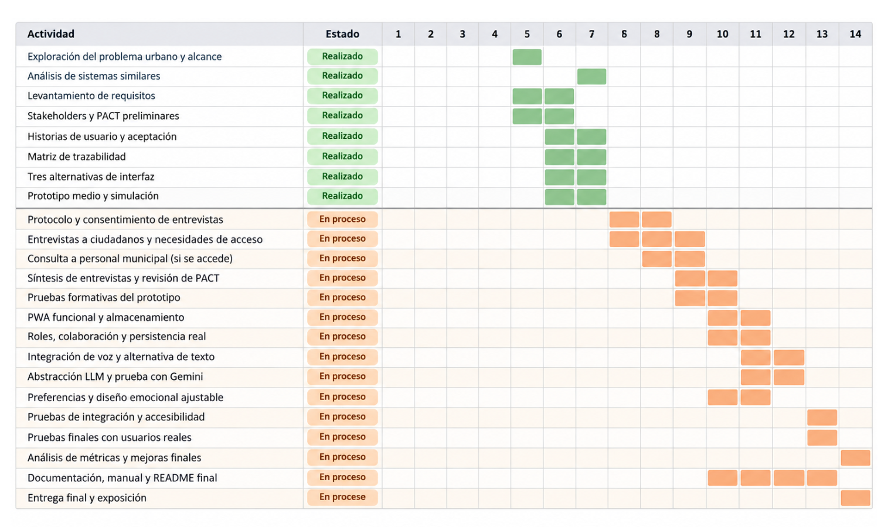
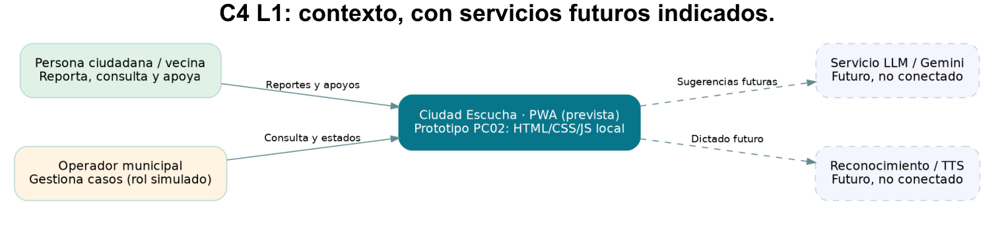
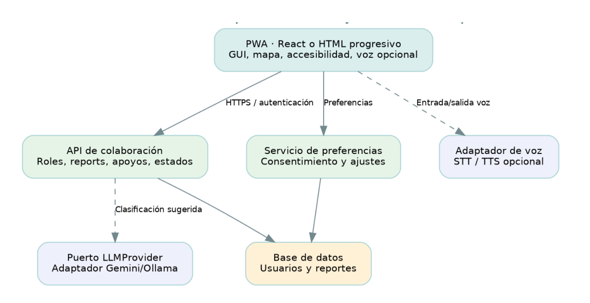

# Ciudad Escucha - PC02

Proyecto del curso de Interacción Humano-Computadora (CC451).

Ciudad Escucha es una propuesta de aplicación para reportar problemas de la ciudad, como pistas dañadas, basura o alumbrado público. En esta entrega incluimos el informe, los prototipos y algunos diagramas del proyecto.

## Cómo abrir el proyecto

1. Descargar el ZIP y descomprimirlo en una carpeta.
2. Entrar a `prototipo final` y abrir `Ciudad_Escucha.html` con Chrome, Edge u otro navegador. No es necesario instalar nada para visualizarlo.
3. Para revisar los prototipos anteriores, entrar a `prototipos` y abrir `alternativas.html`, `prototipo_A.html` o `prototipo_B.html`.
4. El informe está en `docs/Reporte PC2.pdf` (también hay una copia en la carpeta principal).
5. Las diapositivas están en la carpeta de presentación, en formato PDF.

## Carpetas

- `prototipo final/`: versión principal del prototipo en HTML.
- `prototipos/`: alternativas de diseño usadas durante el avance.
- `diagrams/`: flujo de pantallas, Gantt y diagramas C4 en imágenes.
- `data/`: archivos CSV y JSON con los datos del proyecto.
- `docs/`: documento del informe.
- `Presentaci#U00f3n/`: diapositivas de la exposición.

## Diagramas

Estos diagramas se sacaron del PDF del informe y están guardados en `diagrams/` para poder verlos por separado.

**Diagrama de Gantt**

**C4 - Contexto**

**C4 - Contenedores (arquitectura propuesta)**

## Nota

Esta es una entrega de avance. Algunas funciones del prototipo son simulaciones y no están conectadas todavía a una base de datos ni a servicios externos.
